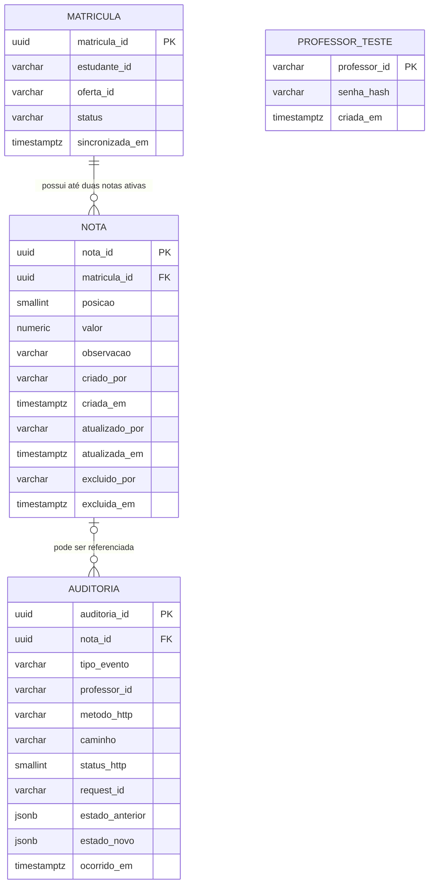

# Modelagem Implementada do Banco de Dados

**Sistema:** API de cadastro de notas  
**Versão:** 2.0
**Banco de dados:** PostgreSQL

## 1. Escopo e decisões implementadas

Este documento descreve o esquema definido pela migration [`001_initial_schema.sql`](./backend-api-notas/migrations/001_initial_schema.sql) e seu uso pela API.

- O banco da API armazena notas, a projeção local de matrículas e auditoria. As rotas não exigem autenticação.
- Estudantes, disciplinas e ofertas são cadastrados em sistemas acadêmicos existentes. A API não passa a ser proprietária desses cadastros.
- `matricula` é uma projeção local do vínculo entre estudante e oferta. A carga/sincronização é feita fora das rotas de notas; a API a consulta para validar matrícula ativa.
- A migration inicial também cria `professor_teste`, resíduo do fluxo de autenticação que foi removido. A tabela não é mais consultada pela API; instalações existentes podem mantê-la sem uso.
- UUIDs são gerados pela aplicação e enviados nas inserções; as colunas UUID não têm valor padrão no banco.
- Notas são excluídas logicamente. Uma nova nota pode ocupar a posição N1 ou N2 se a nota anterior daquela posição tiver sido excluída logicamente; o registro anterior e sua auditoria são preservados.
- A média não é armazenada: é um valor derivado das duas notas ativas, arredondado para uma casa decimal.
- Identificadores externos usam `VARCHAR(100)` para não impor o formato dos sistemas acadêmicos.

## 2. Diagrama entidade-relacionamento



`professor_teste` aparece isolada no diagrama porque a migration ainda a cria por compatibilidade com o esquema inicial; não há relações FK e o código atual não lê nem grava nela. `criado_por`/`atualizado_por`/`excluido_por` e `auditoria.professor_id` são identificadores textuais, não chaves estrangeiras.

## 3. Entidades, restrições e índices

### `matricula`

Projeção local do vínculo entre um estudante e uma oferta. `matricula_id` é chave primária UUID; `(estudante_id, oferta_id)` é único. `status` é `VARCHAR(20)` sem `CHECK` de valores permitidos; a criação de notas exige `status = 'ATIVA'`. `sincronizada_em` tem padrão `CURRENT_TIMESTAMP`. O índice `ix_matricula_oferta_status` atende à consulta por oferta, estado e identificador.

### `nota`

Armazena N1 ou N2 associada a uma matrícula por FK. As restrições garantem posição 1 ou 2, valor entre 0 e 10 com até uma casa decimal e coerência entre cada par de campos de atualização/exclusão (data e autor). Um índice único parcial impede mais de uma nota não excluída por posição e matrícula. Os índices parciais `ix_nota_matricula_ativas` e `ix_nota_matricula_paginacao` apoiam leituras de notas ativas.

`criado_por`, `atualizado_por` e `excluido_por` guardam o ator técnico fixo `api-local` nas mutações feitas pela API, sem FK. Não representam um professor autenticado. Datas de criação/atualização/exclusão usam `TIMESTAMPTZ`; a criação e as alterações são registradas na tabela `auditoria`.

### `auditoria`

Registra eventos `ACESSO`, `CRIACAO`, `ATUALIZACAO` e `EXCLUSAO_LOGICA`. `nota_id` é uma FK anulável para `nota`; os demais dados de requisição e os estados JSON anterior/novo também podem ser nulos, conforme o tipo de evento. Um `CHECK` restringe os tipos de evento e outro restringe `status_http` ao intervalo de 100 a 599 quando informado. Índices ordenam por data e por nota/data. Um trigger `BEFORE UPDATE OR DELETE` chama `impedir_alteracao_auditoria()` e rejeita alterações e remoções; inserções continuam permitidas. Senhas, tokens e segredos não são registrados.

As auditorias de mutação de nota são inseridas na mesma transação da alteração e registram `api-local` em `professor_id`. Eventos de acesso deixam `professor_id` nulo e são tentados depois da resposta HTTP; falhas são reportadas no log do servidor com `requestId`, portanto o registro de acesso não faz parte da transação da operação de nota.

### `professor_teste`

Tabela legada criada pela migration inicial. `professor_id` é chave primária, `senha_hash` guarda o hash que era usado pelo login de teste e `criada_em` tem padrão `CURRENT_TIMESTAMP`. Um `CHECK` rejeita identificador vazio ou composto somente por espaços. O fluxo de login foi removido e a API não usa esta tabela; credenciais antigas podem ser eliminadas manualmente após avaliar o banco local.

## 4. DDL implementado — PostgreSQL

O DDL abaixo corresponde à migration aplicada. A migration usa `IF NOT EXISTS` para tabelas/índices, substitui a função do trigger e recria o trigger. Não depende da extensão `pgcrypto`: os UUIDs são fornecidos pela aplicação.

```sql
CREATE TABLE IF NOT EXISTS matricula (
    matricula_id UUID PRIMARY KEY,
    estudante_id VARCHAR(100) NOT NULL,
    oferta_id VARCHAR(100) NOT NULL,
    status VARCHAR(20) NOT NULL,
    sincronizada_em TIMESTAMPTZ NOT NULL DEFAULT CURRENT_TIMESTAMP,
    CONSTRAINT uq_matricula_estudante_oferta
        UNIQUE (estudante_id, oferta_id)
);

CREATE INDEX IF NOT EXISTS ix_matricula_oferta_status
    ON matricula (oferta_id, status, matricula_id);

CREATE TABLE IF NOT EXISTS professor_teste (
    professor_id VARCHAR(100) PRIMARY KEY,
    senha_hash VARCHAR(250) NOT NULL,
    criada_em TIMESTAMPTZ NOT NULL DEFAULT CURRENT_TIMESTAMP,
    CONSTRAINT ck_professor_teste_id_nao_vazio
        CHECK (length(trim(professor_id)) > 0)
);

CREATE TABLE IF NOT EXISTS nota (
    nota_id UUID PRIMARY KEY,
    matricula_id UUID NOT NULL REFERENCES matricula (matricula_id),
    posicao SMALLINT NOT NULL,
    valor NUMERIC NOT NULL,
    observacao VARCHAR(500),
    criado_por VARCHAR(100) NOT NULL,
    criada_em TIMESTAMPTZ NOT NULL DEFAULT CURRENT_TIMESTAMP,
    atualizado_por VARCHAR(100),
    atualizada_em TIMESTAMPTZ,
    excluido_por VARCHAR(100),
    excluida_em TIMESTAMPTZ,
    CONSTRAINT ck_nota_posicao CHECK (posicao IN (1, 2)),
    CONSTRAINT ck_nota_valor_intervalo CHECK (valor >= 0 AND valor <= 10),
    CONSTRAINT ck_nota_uma_casa_decimal CHECK (valor = trunc(valor, 1)),
    CONSTRAINT ck_nota_atualizacao_coerente
        CHECK ((atualizada_em IS NULL) = (atualizado_por IS NULL)),
    CONSTRAINT ck_nota_exclusao_coerente
        CHECK ((excluida_em IS NULL) = (excluido_por IS NULL))
);

CREATE UNIQUE INDEX IF NOT EXISTS uq_nota_ativa_matricula_posicao
    ON nota (matricula_id, posicao)
    WHERE excluida_em IS NULL;

CREATE INDEX IF NOT EXISTS ix_nota_matricula_ativas
    ON nota (matricula_id, posicao)
    WHERE excluida_em IS NULL;

CREATE INDEX IF NOT EXISTS ix_nota_matricula_paginacao
    ON nota (matricula_id, nota_id)
    WHERE excluida_em IS NULL;

CREATE TABLE IF NOT EXISTS auditoria (
    auditoria_id UUID PRIMARY KEY,
    nota_id UUID REFERENCES nota (nota_id),
    tipo_evento VARCHAR(30) NOT NULL,
    professor_id VARCHAR(100),
    metodo_http VARCHAR(10),
    caminho VARCHAR(500),
    status_http SMALLINT,
    request_id VARCHAR(100),
    estado_anterior JSONB,
    estado_novo JSONB,
    ocorrido_em TIMESTAMPTZ NOT NULL DEFAULT CURRENT_TIMESTAMP,
    CONSTRAINT ck_auditoria_tipo_evento CHECK (
        tipo_evento IN ('ACESSO', 'CRIACAO', 'ATUALIZACAO', 'EXCLUSAO_LOGICA')
    ),
    CONSTRAINT ck_auditoria_status_http
        CHECK (status_http IS NULL OR status_http BETWEEN 100 AND 599)
);

CREATE INDEX IF NOT EXISTS ix_auditoria_ocorrido_em
    ON auditoria (ocorrido_em DESC);

CREATE INDEX IF NOT EXISTS ix_auditoria_nota_ocorrido_em
    ON auditoria (nota_id, ocorrido_em DESC)
    WHERE nota_id IS NOT NULL;

CREATE OR REPLACE FUNCTION impedir_alteracao_auditoria()
RETURNS trigger
LANGUAGE plpgsql
AS $$
BEGIN
    RAISE EXCEPTION 'Registros de auditoria sao imutaveis';
END;
$$;

DROP TRIGGER IF EXISTS trg_auditoria_imutavel ON auditoria;
CREATE TRIGGER trg_auditoria_imutavel
    BEFORE UPDATE OR DELETE ON auditoria
    FOR EACH ROW EXECUTE FUNCTION impedir_alteracao_auditoria();
```

## 5. Consulta de notas e média

A API pode consultar as notas ativas por matrícula e calcular a média na consulta ou na camada de serviço. Exemplo SQL com a média arredondada:

```sql
SELECT
    m.estudante_id,
    m.oferta_id,
    MAX(n.valor) FILTER (WHERE n.posicao = 1) AS n1,
    MAX(n.valor) FILTER (WHERE n.posicao = 2) AS n2,
    CASE
        WHEN COUNT(n.nota_id) FILTER (WHERE n.posicao IN (1, 2)) = 2
        THEN ROUND(
            (
                MAX(n.valor) FILTER (WHERE n.posicao = 1)
                + MAX(n.valor) FILTER (WHERE n.posicao = 2)
            ) / 2,
            1
        )
        ELSE NULL
    END AS media
FROM matricula m
LEFT JOIN nota n
    ON n.matricula_id = m.matricula_id
   AND n.excluida_em IS NULL
WHERE m.estudante_id = :estudante_id
  AND m.oferta_id = :oferta_id
  AND m.status = 'ATIVA'
GROUP BY m.estudante_id, m.oferta_id;
```

## 6. Fluxos implementados

### Cadastro de nota

1. A API procura a matrícula por oferta e estudante com `status = 'ATIVA'`.
2. Em uma transação, insere a nota e seu evento `CRIACAO` em `auditoria`. A restrição única parcial impede duplicidade concorrente da posição ativa.
3. Se a matrícula não estiver ativa, a API rejeita o cadastro; se a posição já estiver ocupada, retorna conflito sem substituir a nota existente.

As mutações da API gravam o ator técnico `api-local` em `criado_por` e na auditoria; esse valor não identifica uma pessoa.

### Atualização de nota

Em uma transação, a API bloqueia a nota ativa, atualiza valor e/ou observação e preenche `atualizado_por`/`atualizada_em`; o evento `ATUALIZACAO`, com estados anterior e novo, é inserido atomicamente.

### Exclusão lógica

Em uma transação, a API bloqueia a nota ativa, preenche `excluida_em`/`excluido_por` e insere o evento `EXCLUSAO_LOGICA`. Consultas e média excluem registros com `excluida_em IS NOT NULL`.

### Registro de acesso

Após o término das requisições que passam pelos controles de host e CORS, a API tenta inserir um evento `ACESSO` com método, caminho, status, `request_id` e professor quando conhecido. O resultado dessa gravação não altera a resposta enviada ao cliente; falhas são registradas no log do servidor.

## 7. Segurança, acesso e manutenção

- A aplicação deve conectar-se ao PostgreSQL com usuário de privilégio mínimo.
- As rotas não exigem autenticação. A API deve permanecer restrita a loopback e a dados locais de teste; não deve ser exposta publicamente.
- O acesso ao banco deve usar conexões protegidas e segredos mantidos em cofre apropriado, nunca em logs ou no repositório.
- O trigger do banco impede `UPDATE` e `DELETE` em `auditoria`; as inserções feitas pela aplicação permanecem permitidas.
- Como a retenção é indeterminada, devem ser planejados backup, recuperação, monitoramento de crescimento e arquivamento que não implique remoção dos registros.
- A API aceita paginação com até 10 itens por página e ordenação estável.
- O índice `ix_matricula_oferta_status` atende à busca dos estudantes matriculados em uma oferta; o índice parcial das notas atende à leitura das notas ativas por matrícula.
- A média deve ser calculada a partir das notas ativas para evitar inconsistência entre valores armazenados e a regra institucional.

## 8. Limites conhecidos do esquema

- A migration não define um valor padrão UUID no banco nem aplica `CHECK` para os valores permitidos em `matricula.status`; a aplicação e as rotinas que carregam a projeção devem fornecer UUIDs e respeitar o estado `ATIVA`.
- A tabela `professor_teste` é um resíduo não utilizado da migration inicial; o código atual não autentica usuários.
- A migration não impõe prazo de retenção de auditoria; backup, controle de acesso e políticas de retenção devem seguir as regras institucionais.
