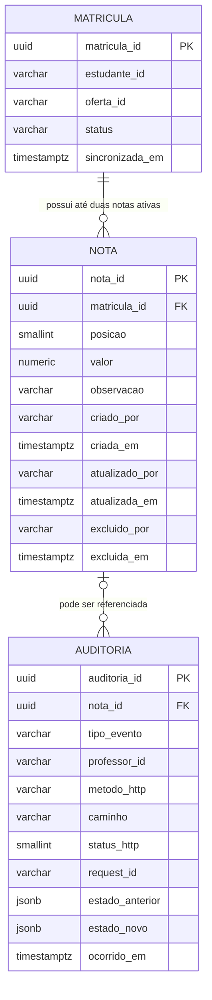

# Proposta de Modelagem do Banco de Dados

**Sistema:** API de cadastro de notas  
**Versão:** 1.0  
**Banco de dados definido:** PostgreSQL

## 1. Objetivo e decisões da proposta

Esta proposta modela o armazenamento das notas, das matrículas necessárias para validá-las e dos registros de auditoria.

- No MVP, o banco da API é responsável por notas e auditoria; não há armazenamento de chaves de API.
- Estudantes, disciplinas e ofertas são cadastrados em sistemas acadêmicos existentes. A API não passa a ser proprietária desses cadastros.
- Para validar matrícula e aplicar chaves estrangeiras sem depender de uma transação distribuída, a proposta mantém uma projeção local de matrículas. Essa projeção é sincronizada a partir do sistema acadêmico e somente leitura para a API. Se os sistemas compartilharem o mesmo banco, ela pode ser substituída por referências às tabelas acadêmicas oficiais.
- O identificador do professor vem do contexto autenticado do portal e é armazenado como identificador externo; a API não armazena a senha nem cria cadastro de professores.
- Notas são excluídas logicamente. Uma nova nota pode ocupar a posição N1 ou N2 se a nota anterior daquela posição tiver sido excluída logicamente; o registro anterior e sua auditoria são preservados.
- A média não é armazenada: é um valor derivado das duas notas ativas, arredondado para uma casa decimal.
- Os exemplos de identificadores externos usam `VARCHAR(100)` para não impor o formato dos sistemas acadêmicos.

## 2. Diagrama entidade-relacionamento



## 3. Entidades e regras

### `matricula`

Projeção local e somente leitura do vínculo entre um estudante e uma oferta. A combinação `(estudante_id, oferta_id)` deve ser única. A API só permite registrar nota quando a matrícula estiver ativa. A sincronização deve atualizar o estado e o horário de sincronização sem criar matrículas pelo endpoint de notas.

### `nota`

Armazena N1 ou N2 associada à matrícula. O valor fica entre 0 e 10, com no máximo uma casa decimal. Uma restrição única parcial impede mais de uma nota ativa na mesma posição da matrícula; uma nota logicamente excluída não participa das consultas normais nem da média.

`criado_por`, `atualizado_por` e `excluido_por` guardam o identificador do professor fornecido em contexto confiável pelo portal. A trilha completa de alterações fica em `auditoria`.

### `auditoria`

Registra acessos e operações de nota, incluindo requisições recusadas quando possível. Guarda o resultado HTTP, a identidade do professor quando conhecida e os estados anterior e novo nas alterações. Não deve armazenar senhas, tokens ou outros segredos. Os registros são mantidos por tempo indeterminado e não devem ser atualizados ou removidos pela aplicação.

## 4. DDL inicial — PostgreSQL

O DDL é uma base para discussão e deve ser adaptado ao esquema de integração do sistema acadêmico e às políticas operacionais da instituição.

```sql
CREATE EXTENSION IF NOT EXISTS pgcrypto;

CREATE TABLE matricula (
    matricula_id UUID PRIMARY KEY DEFAULT gen_random_uuid(),
    estudante_id VARCHAR(100) NOT NULL,
    oferta_id VARCHAR(100) NOT NULL,
    status VARCHAR(20) NOT NULL,
    sincronizada_em TIMESTAMPTZ NOT NULL DEFAULT CURRENT_TIMESTAMP,
    CONSTRAINT uq_matricula_estudante_oferta
        UNIQUE (estudante_id, oferta_id)
);

CREATE INDEX ix_matricula_oferta_status
    ON matricula (oferta_id, status, matricula_id);

CREATE TABLE nota (
    nota_id UUID PRIMARY KEY DEFAULT gen_random_uuid(),
    matricula_id UUID NOT NULL REFERENCES matricula (matricula_id),
    posicao SMALLINT NOT NULL,
    valor NUMERIC NOT NULL,
    observacao VARCHAR(500),
    criado_por VARCHAR(100) NOT NULL,
    criada_em TIMESTAMPTZ NOT NULL DEFAULT CURRENT_TIMESTAMP,
    atualizado_por VARCHAR(100),
    atualizada_em TIMESTAMPTZ,
    excluido_por VARCHAR(100),
    excluida_em TIMESTAMPTZ,
    CONSTRAINT ck_nota_posicao
        CHECK (posicao IN (1, 2)),
    CONSTRAINT ck_nota_valor_intervalo
        CHECK (valor >= 0 AND valor <= 10),
    CONSTRAINT ck_nota_uma_casa_decimal
        CHECK (valor = trunc(valor, 1)),
    CONSTRAINT ck_nota_atualizacao_coerente
        CHECK ((atualizada_em IS NULL) = (atualizado_por IS NULL)),
    CONSTRAINT ck_nota_exclusao_coerente
        CHECK ((excluida_em IS NULL) = (excluido_por IS NULL))
);

CREATE UNIQUE INDEX uq_nota_ativa_matricula_posicao
    ON nota (matricula_id, posicao)
    WHERE excluida_em IS NULL;

CREATE INDEX ix_nota_matricula_ativas
    ON nota (matricula_id, posicao)
    WHERE excluida_em IS NULL;

CREATE TABLE auditoria (
    auditoria_id UUID PRIMARY KEY DEFAULT gen_random_uuid(),
    nota_id UUID REFERENCES nota (nota_id),
    tipo_evento VARCHAR(30) NOT NULL,
    professor_id VARCHAR(100),
    metodo_http VARCHAR(10),
    caminho VARCHAR(500),
    status_http SMALLINT,
    request_id VARCHAR(100),
    estado_anterior JSONB,
    estado_novo JSONB,
    ocorrido_em TIMESTAMPTZ NOT NULL DEFAULT CURRENT_TIMESTAMP,
    CONSTRAINT ck_auditoria_tipo_evento
        CHECK (tipo_evento IN (
            'ACESSO',
            'CRIACAO',
            'ATUALIZACAO',
            'EXCLUSAO_LOGICA'
        )),
    CONSTRAINT ck_auditoria_status_http
        CHECK (status_http IS NULL OR status_http BETWEEN 100 AND 599)
);

CREATE INDEX ix_auditoria_ocorrido_em
    ON auditoria (ocorrido_em DESC);

CREATE INDEX ix_auditoria_nota_ocorrido_em
    ON auditoria (nota_id, ocorrido_em DESC)
    WHERE nota_id IS NOT NULL;

CREATE INDEX ix_nota_matricula_paginacao
    ON nota (matricula_id, nota_id)
    WHERE excluida_em IS NULL;
```

## 5. Consulta de notas e média

A API pode consultar as notas ativas por matrícula e calcular a média na consulta ou na camada de serviço. Exemplo SQL com a média arredondada:

```sql
SELECT
    m.estudante_id,
    m.oferta_id,
    MAX(n.valor) FILTER (WHERE n.posicao = 1) AS n1,
    MAX(n.valor) FILTER (WHERE n.posicao = 2) AS n2,
    CASE
        WHEN COUNT(n.nota_id) FILTER (WHERE n.posicao IN (1, 2)) = 2
        THEN ROUND(
            (
                MAX(n.valor) FILTER (WHERE n.posicao = 1)
                + MAX(n.valor) FILTER (WHERE n.posicao = 2)
            ) / 2,
            1
        )
        ELSE NULL
    END AS media
FROM matricula m
LEFT JOIN nota n
    ON n.matricula_id = m.matricula_id
   AND n.excluida_em IS NULL
WHERE m.estudante_id = :estudante_id
  AND m.oferta_id = :oferta_id
  AND m.status = 'ATIVA'
GROUP BY m.estudante_id, m.oferta_id;
```

## 6. Fluxos transacionais recomendados

### Cadastro ou atualização de nota

1. Receber chamadas somente de ambiente controlado, com acesso limitado por rede; no MVP, não validar chave de API.
2. Obter a identidade do professor por canal autenticado e confiável; não confiar em um identificador arbitrário enviado pelo cliente HTTP.
3. Iniciar transação e localizar a matrícula ativa pela oferta e pelo estudante.
4. Inserir ou atualizar a nota. A restrição única parcial protege contra cadastros concorrentes da mesma posição.
5. Inserir o evento de auditoria na mesma transação da alteração da nota.
6. Confirmar a transação. Em conflito de posição já ocupada, retornar conflito sem substituir o registro.

### Exclusão lógica

Atualizar `excluida_em` e `excluido_por`, e inserir o evento `EXCLUSAO_LOGICA` na mesma transação. As consultas regulares e o cálculo da média devem filtrar `excluida_em IS NULL`.

### Registro de acesso

Registrar acessos e tentativas recusadas por controles de rede ou validações da aplicação, sem armazenar credenciais ou outros segredos. O evento registra horário, rota, resultado HTTP e `request_id`, além do `professor_id` quando conhecido.

## 7. Segurança, acesso e manutenção

- A aplicação deve conectar-se ao PostgreSQL com usuário de privilégio mínimo.
- A API não deve ser exposta publicamente sem uma decisão explícita sobre autenticação e controles de acesso; o MVP depende de restrição de rede e ambiente controlado.
- O acesso ao banco deve usar conexões protegidas e segredos mantidos em cofre apropriado, nunca em logs ou no repositório.
- A conta da aplicação não deve poder atualizar ou apagar registros de auditoria. Recomenda-se separar as permissões de escrita de auditoria e impor política imutável no banco ou na infraestrutura.
- Como a retenção é indeterminada, devem ser planejados backup, recuperação, monitoramento de crescimento e arquivamento que não implique remoção dos registros.
- A lista de 10 itens por página deve ser aplicada pela API com ordenação estável, preferencialmente por chave primária ou cursor.
- O índice `ix_matricula_oferta_status` atende à busca dos estudantes matriculados em uma oferta; o índice parcial das notas atende à leitura das notas ativas por matrícula.
- A média deve ser calculada a partir das notas ativas para evitar inconsistência entre valores armazenados e a regra institucional.

## 8. Pontos a confirmar antes da implementação

- Formato e origem oficial dos identificadores de estudante, oferta, matrícula e professor.
- Como a projeção local de matrículas será sincronizada e qual latência de atualização é aceitável.
- Protocolo confiável entre portal e API para transportar a identidade do professor.
- Política institucional para corrigir ou reativar nota excluída logicamente.
- Esquema de auditoria conforme as regras de privacidade, acesso e retenção da instituição.
